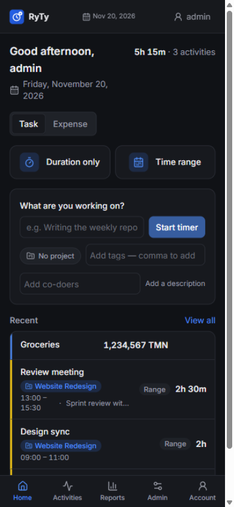
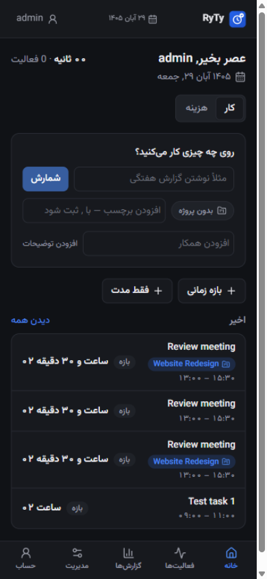
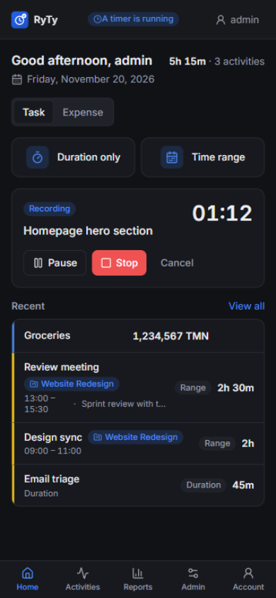
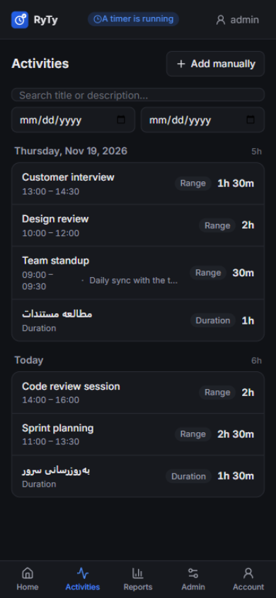
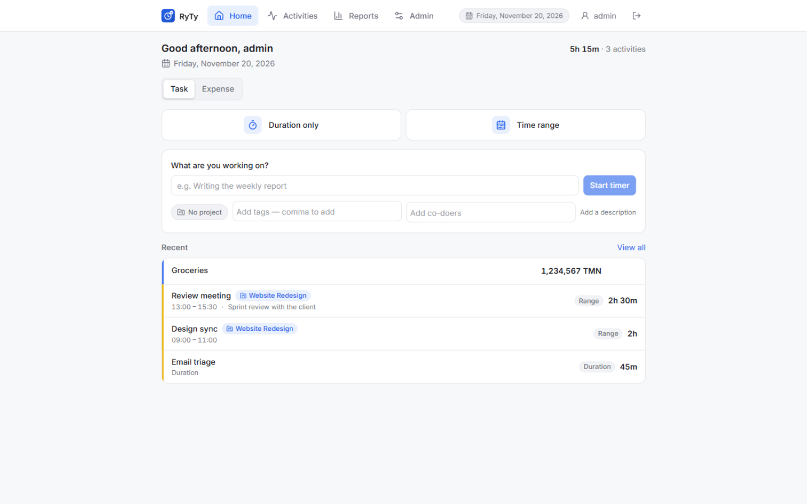
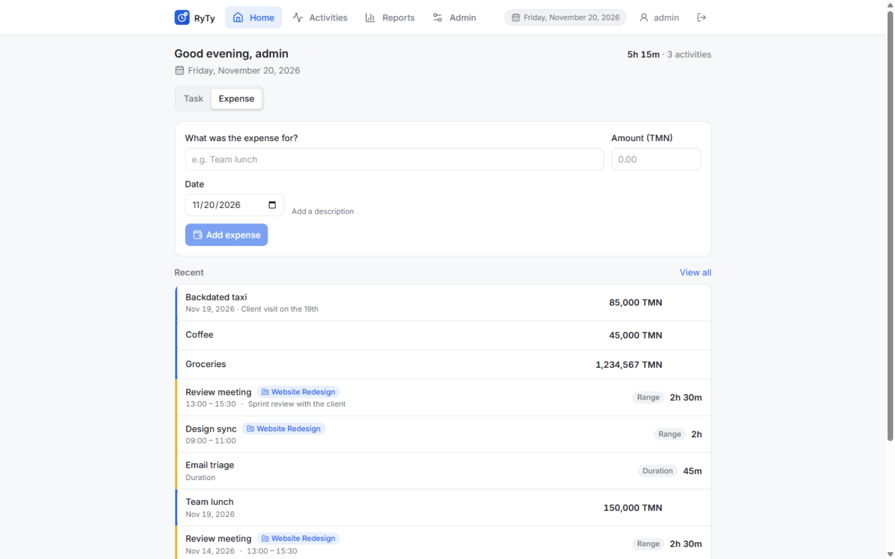
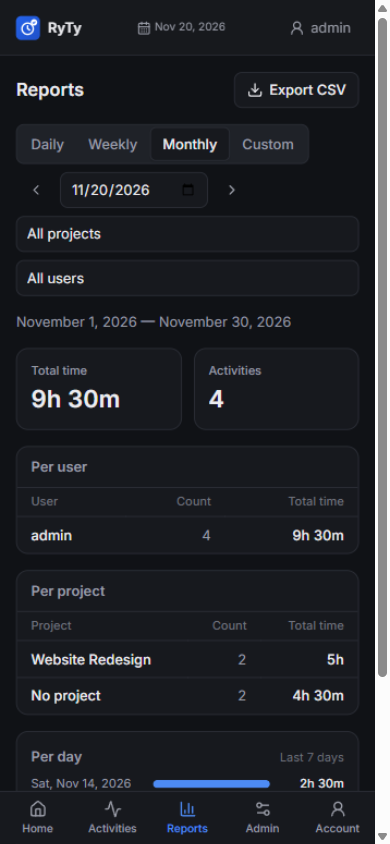
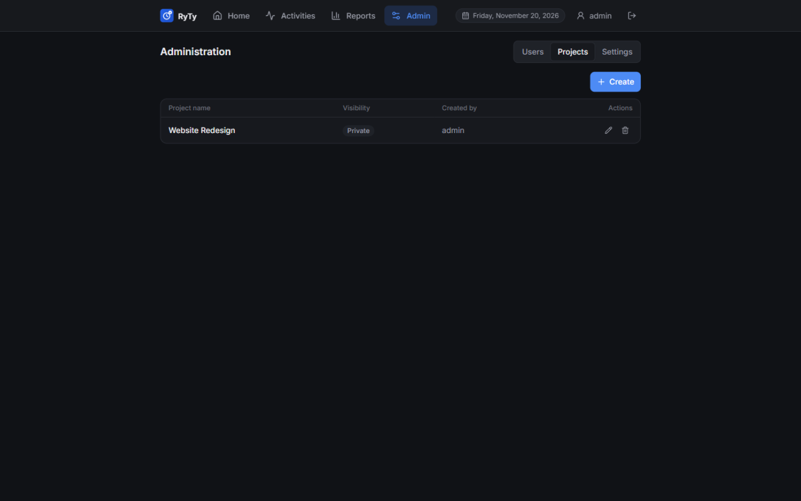
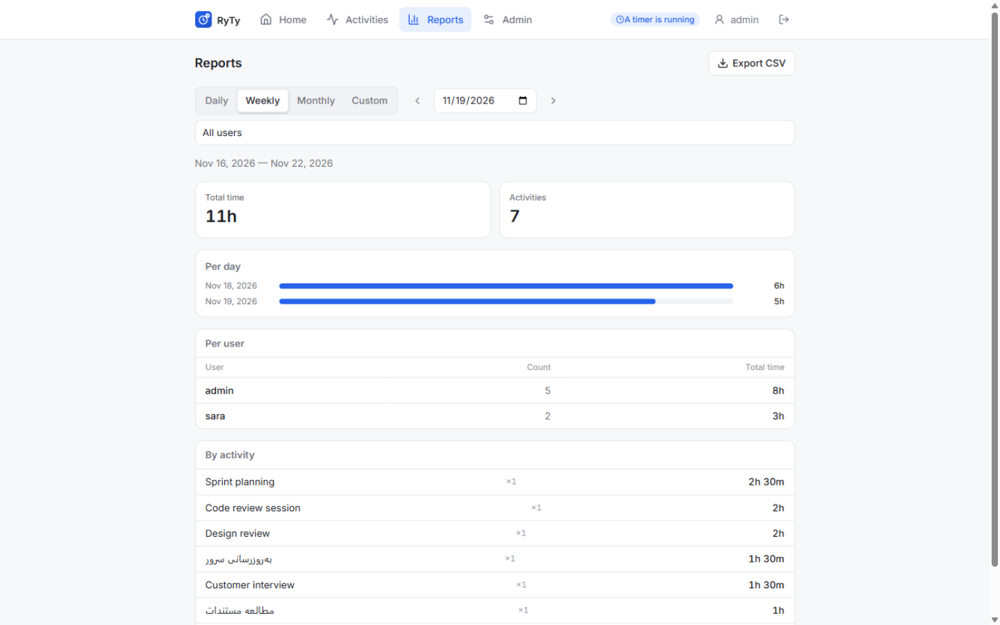

<div align="center">


# RyTy · رای‌تی

**Minimal team activity & time tracking — simple, fast, mobile-first.**

**ردیابی ساده و سریع فعالیت و زمان تیم — موبایل‌محور و کم‌حجم**

[](.github/workflows/ci.yml)


https://github.com/user-attachments/assets/dac588f2-7986-4398-bf5c-4a08c5bdab78

*▶ Watch the 60-second promo — the agent interviews, mirrors, tests, and reports, end to end.*

[English](./README.md) · **فارسی**

</div>

---

**رای‌تی** ابزاری سبک برای ثبت کاری که تیم روی آن کار می‌کند، مدت زمان آن و زمان وقوع آن است — بدون پیچیدگی اضافه.

</div>

## ✨ رای‌تی چیست؟

۱. برنامه را باز کنید
۲. بنویسید روی چه کاری کار می‌کنید → زمان‌سنج را start کنید (یا زمان را دستی ثبت کنید)
۳. خارج شوید

- ⏱️ **زمان‌سنج** — شروع / توقف / ادامه / پایان / لغو؛ محاسبهٔ زمان **سمت سرور** است و با رفرش یا بستن مرورگر از بین نمی‌رود
- ✍️ **ثبت دستی** — بازهٔ زمانی (با تشخیص هم‌پوشانی) یا فقط مدت
- 💸 **هزینه‌ها** — ثبت سریع هزینه از تب دوم صفحهٔ خانه، با ورودی مبلغ جداکنندهٔ هزارگان؛ واحد پول از تنظیمات مدیر (TMN، IRR، USD و…)
- 🗓️ **نمایش تاریخ جلالی یا میلادی** — تنظیم مدیر؛ داده‌های ذخیره‌شده همیشه میلادی/UTC می‌مانند و تاریخ امروز در هدر برنامه نشان داده می‌شود
- 📁 **پروژه‌ها** — مدیر پروژه‌های عمومی (برای همهٔ تیم) یا خصوصی تعریف می‌کند؛ کاربران می‌توانند پروژه خودشان را بسازند یا به مدیر پیشنهاد دهند؛ هر کس می‌تواند **پروژه پیش‌فرض** خود را انتخاب کند
- 🏷️ **برچسب‌ها** — برچسب‌های عمومی که همه می‌سازند؛ کافی است نام برچسب را بنویسید و با `,` آن را اضافه کنید (با پیشنهاد لحظه‌ای)
- 👥 **همکاران** — برای هر فعالیت، همکار (جفت‌اجراکننده) اضافه کنید؛ آن‌ها فعالیت را در فهرست خود می‌بینند و می‌توانند ویرایش یا حذفش کنند، اما زمان به شما تعلق می‌گیرد
- 🧹 **حذف نرم** — فعالیت‌ها/هزینه‌های حذف‌شده از برنامه پنهان می‌شوند اما برای ممیزی در پایگاه‌داده می‌مانند
- 📊 **گزارش‌ها** — روزانه / هفتگی / ماهانه / دلخواه، به تفکیک روز، کاربر، پروژه و فعالیت، همراه با **خروجی CSV** (UTF-8 و سازگار با فارسی)
- 👥 **دو نقش** — مدیر (مدیریت کاربران و تنظیمات) و کاربر؛ بدون ثبت‌نام عمومی
- 🔒 **امنیت** — کوکی نشست با توکن هش‌شده، هش گذرواژه با PBKDF2، محدودسازی تلاش ورود، محافظت CSRF، تغییر اجباری گذرواژه در اولین ورود، راه‌اندازی مدیر از طریق رمز محیطی
- 🌍 **انگلیسی + فارسی** — چیدمان کامل راست‌به‌چپ/چپ‌به‌راست، ارقام و تاریخ فارسی، قلم وزیرمتن
- 🌗 **پوسته روشن / تیره / سیستم**
- 📱 **رابط موبایل‌محور** با چیدمان فشرده برای دسکتاپ
- ☁️ **دو مقصد استقرار با یک کدپایه** — Cloudflare Workers + D1 یا Docker + SQLite

## 🖼️ تصاویر برنامه

| داشبورد (موبایل، تیره)                                        | داشبورد فارسی (راست‌به‌چپ، تاریخ جلالی)                        |
| ------------------------------------------------------------- | -------------------------------------------------------------- |
|  |  |

| زمان‌سنج فعال                                       | فعالیت‌ها                                                 |
| --------------------------------------------------- | --------------------------------------------------------- |
|  |  |

| داشبورد دسکتاپ (روشن)                                           | هزینه‌ها (دسکتاپ، روشن)                                  |
| --------------------------------------------------------------- | -------------------------------------------------------- |
|  |  |

| گزارش‌ها (موبایل)                                             | مدیریت — پروژه‌ها                                                     |
| ------------------------------------------------------------- | --------------------------------------------------------------------- |
|  |  |

| گزارش‌ها (دسکتاپ)                                       |
| ------------------------------------------------------- |
|  |

## 🚀 شروع سریع

```bash
npm install
D1_DATABASE_ID=00000000-0000-0000-0000-000000000000 npm run config:generate
# ↑ ساخت wrangler.jsonc برای محیط محلی — هر UUID معتبری کافی است؛
#   شناسه پایگاه‌داده واقعی تولید را اینجا هرگز استفاده نکنید
npm run db:migrate:d1:local   # ساخت اسکیمای D1 محلی
npm run dev                   # سرور توسعه Vite
```

سپس فایل `.dev.vars` (نادیده‌گرفته‌شده در گیت) با `INITIAL_ADMIN_USERNAME` /
`INITIAL_ADMIN_PASSWORD` بسازید و با همین اطلاعات وارد شوید.

## ☁️ استقرار روی Cloudflare

فایل واقعی `wrangler.jsonc` هنگام استقرار از روی قالب کامیت‌شده
(`wrangler.example.jsonc`) با شناسه پایگاه‌داده شما **تولید می‌شود**؛ هیچ
پیکربندی وابسته به محیط در گیت قرار نمی‌گیرد.

```bash
# ۱. پایگاه‌داده خودتان را بسازید (یا موجود را ادامه دهید — برای استقرار دوباره
#    یک نمونه موجود، پایگاه‌داده جدید نسازید)
npx wrangler d1 create ryty

# ۲. تولید wrangler.jsonc از قالب با شناسه پایگاه‌داده شما
D1_DATABASE_ID=<database_id-مرحله-۱> npm run config:generate

# ۳. پیکربندی مدیر اولیه (رمز — هرگز در گیت)
npx wrangler secret put INITIAL_ADMIN_PASSWORD
# اختیاری: npx wrangler secret put INITIAL_ADMIN_USERNAME  (پیش‌فرض: admin)

# ۴. ساخت، اعمال مهاجرت‌های ریموت و استقرار
npm run deploy
```

با اطلاعات مدیر اولیه وارد شوید؛ برنامه به‌صورت **اجباری** گذرواژه جدید
می‌خواهد. اگر رمز تنظیم نشده باشد، صفحه «راه‌اندازی اولیه» دستورالعمل دقیق را
نشان می‌دهد.

**اتصال گیت‌هاب (Cloudflare Workers Builds):** دستور ساخت
`npm run config:generate && npm run build`، دستور استقرار `npm run deploy:cf`
و مقدار `D1_DATABASE_ID` زیر **Build variables and secrets** (متغیرهای Build
همان متغیرها/رمزهای زمان اجرای Worker نیستند).

📖 **راهنمای کامل مرحله‌به‌مرحله:** [deployment-guide.fa.md](./deployment-guide.fa.md)
(English: [deployment-guide.md](./deployment-guide.md))

## 🐳 استقرار با Docker

```bash
cp .env.example .env
# در .env مقدار INITIAL_ADMIN_PASSWORD را تنظیم کنید
docker compose up -d --build
```

- برنامه و API روی یک دامنه: `http://localhost:3000`
- داده‌ها در ولوم `ryty-data` ذخیره می‌شوند — **به‌روزرسانی تصویر هیچ‌گاه داده‌ها را حذف نمی‌کند** (تست شده)
- بررسی سلامت: `GET /api/health`

## ⚙️ متغیرهای محیطی

| متغیر                    | لازم     | توضیح                                                    |
| ------------------------ | -------- | -------------------------------------------------------- |
| `D1_DATABASE_ID`         | Build در Cloudflare | شناسه پایگاه‌داده D1 شما؛ حین ساخت داخل `wrangler.jsonc` تولیدی تزریق می‌شود |
| `INITIAL_ADMIN_USERNAME` | –        | نام کاربری مدیر اولیه (پیش‌فرض `admin`)                  |
| `INITIAL_ADMIN_PASSWORD` | ✅ (رمز) | گذرواژه مدیر اولیه؛ فقط تا اولین ورود و سپس تغییر اجباری |
| `APP_TIMEZONE`           | –        | منطقه زمانی پیش‌فرض گروه‌بندی روزانه (پیش‌فرض `UTC`)     |
| `DEFAULT_LANGUAGE`       | –        | زبان پیش‌فرض `en` \| `fa`                                |
| `RYTY_PORT`              | –        | پورت میزبان Docker (پیش‌فرض `3000`)                      |
| `DATA_PATH`              | –        | مسیر فایل SQLite در Docker (پیش‌فرض `/data/ryty.db`)     |

## 🧪 توسعه

```bash
npm run typecheck   # بررسی نوع سخت‌گیرانه
npm test            # ۹۷ تست واحد و یکپارچه
npm run build       # ساخت تولیدی کلاینت و سرور
```

## 📄 مستندات

- [deployment-guide.fa.md](./deployment-guide.fa.md) — **راهنمای کامل استقرار روی Cloudflare** (دستی + اتصال گیت‌هاب) · [English](./deployment-guide.md)
- [PROJECT-SPECIFICATION.md](PROJECT-SPECIFICATION.md) — مشخصات کامل محصول و فنی
- [AGENTS.md](AGENTS.md) — دستورالعمل عامل‌های کدنویسی
- [PROGRESS.md](PROGRESS.md) — وضعیت پیاده‌سازی و گزارش تست‌ها

## 📜 مجوز

[MIT](./LICENSE)

---

<div align="center">

Made with care · ساخته‌شده با دقت

</div>
