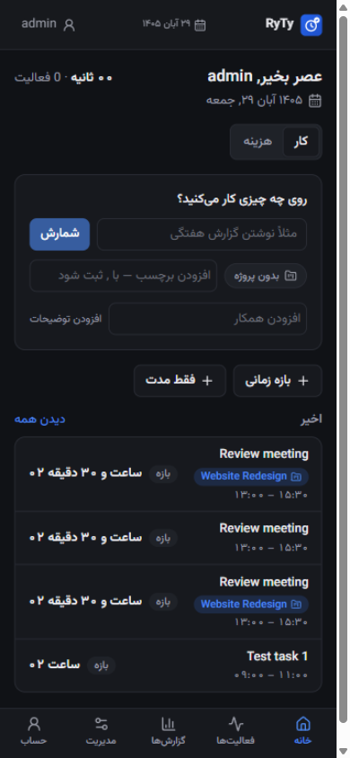
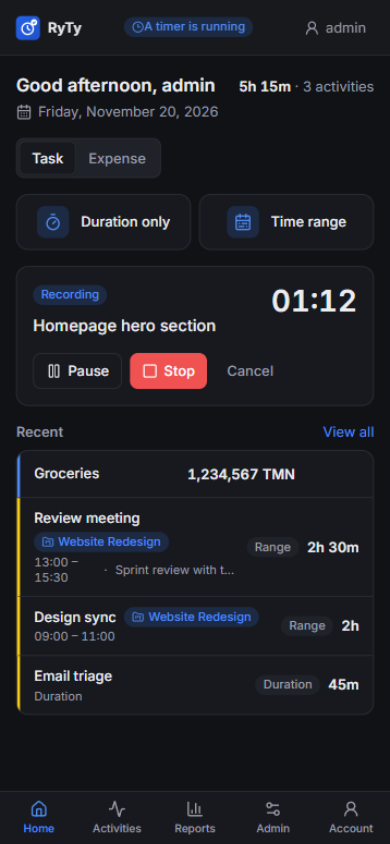
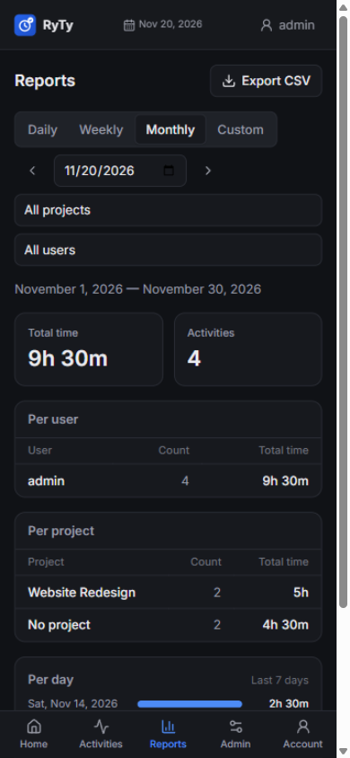
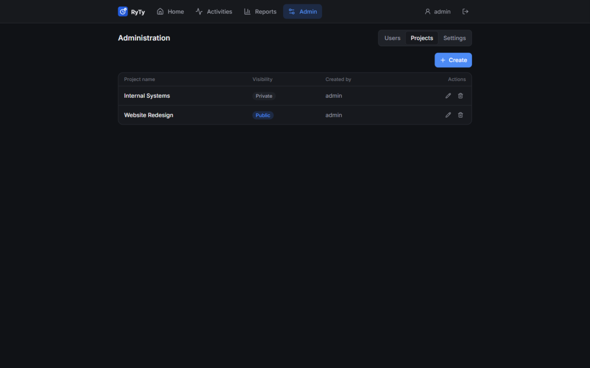

<div align="center">


# RyTy · رای‌تی

**Minimal team activity & time tracking — simple, fast, mobile-first.**

**ردیابی ساده و سریع فعالیت و زمان تیم — موبایل‌محور و کم‌حجم**

[](.github/workflows/ci.yml)


**English** · [فارسی](#فارسی--persian)

</div>

---

## ✨ What is RyTy?

RyTy is a lightweight tool for teams to record **what** they worked on, **how long** it took, and **when** — nothing more. The core loop is three interactions:

1. Open the app
2. Type what you're working on → start the timer (or add time manually)
3. Leave

- ⏱️ **Timer tracking** — start / pause / resume / stop; timekeeping is computed **server-side** and survives refreshes and closed tabs
- ✍️ **Manual entry** — time range (with overlap detection) or duration-only
- 📁 **Projects** — admins define public (team-wide) or private projects; users can create their own or suggest one to the admin for public review; everyone can pick a **default project**
- 🏷️ **Tags** — public tags anyone can create; type a tag and press `,` to attach it, with instant autocomplete
- 📊 **Reports** — daily / weekly / monthly / custom, grouped by day, user, project and activity, with **CSV export** (UTF-8, Persian-safe)
- 👥 **Two roles** — Admin (user management, app settings) and User; no public registration
- 🔒 **Secure by design** — session cookies (hashed tokens, HttpOnly), PBKDF2 password hashing, login rate limiting, CSRF protection, mandatory first-login password change, secret-based admin bootstrap
- 🌍 **English + Persian (فارسی)** — full RTL/LTR layouts, Persian digits & dates, Vazirmatn typography
- 🌗 **Light / dark / system themes**
- 📱 **Mobile-first UI** with a compact desktop layout
- ☁️ **Two deployment targets from one codebase** — Cloudflare Workers + D1, or Docker + SQLite

## 🖼️ Screenshots

| Mobile (dark) | Mobile — Persian RTL |
| --- | --- |
|  |  |

| Timer running | Activities |
| --- | --- |
|  |  |

| Desktop dashboard (light) | Desktop reports (light) |
| --- | --- |
|  |  |

| Reports (mobile) | Administration — projects |
| --- | --- |
|  |  |

## 🏗️ Architecture

One monorepo, one shared codebase, two deployment targets:

```
ryty/
├── frontend/          # React 19 + Vite + Tailwind CSS 4 SPA (EN/FA, RTL, themes)
├── backend/           # Hono REST API (runtime-agnostic)
│   └── src/
│       ├── routes/        # auth, activities, timer, reports, admin
│       ├── middleware/    # auth, roles, CSRF
│       ├── services/      # business logic
│       ├── repositories/  # data access (drizzle)
│       ├── database/      # schema + D1 / libsql adapters + migrations
│       └── runtime/       # cloudflare.ts (Worker) · node.ts (Docker)
├── shared/            # types + zod schemas shared by FE & BE
├── migrations/        # SQL migrations (D1 & SQLite compatible)
├── docker/            # Dockerfile
└── wrangler.jsonc     # Cloudflare configuration
```

| | Cloudflare (primary) | Docker |
| --- | --- | --- |
| Server | Single Worker (Hono) | Node 22 + `@hono/node-server` |
| Frontend | Workers Assets (same origin) | Served by the same Node server |
| Database | Cloudflare D1 | SQLite file on a volume |
| Deploy | `npm run deploy` | `docker compose up -d --build` |

## 🚀 Quick start (local development)

```bash
npm install
npm run db:migrate:d1:local   # create local D1 schema
npm run dev                   # Vite dev server (Cloudflare runtime)
```

### Run the Docker/Node build locally

```bash
npm run build
INITIAL_ADMIN_USERNAME=admin INITIAL_ADMIN_PASSWORD=choose-a-long-password npm start
```

## ☁️ Deploy to Cloudflare

1. **Create the database and set its id**
   ```bash
   npx wrangler d1 create ryty
   # → paste the returned database_id into wrangler.jsonc
   ```
2. **Apply migrations**
   ```bash
   npx wrangler d1 migrations apply ryty --remote
   ```
3. **Configure the initial administrator (secret — never in Git)**
   ```bash
   npx wrangler secret put INITIAL_ADMIN_PASSWORD
   # optional: npx wrangler secret put INITIAL_ADMIN_USERNAME  (default: admin)
   ```
4. **Deploy**
   ```bash
   npm run deploy
   ```
5. Open the app. If the secret is missing you will see a **setup screen** with exact instructions — RyTy never creates an insecure default admin and never asks for secrets in a web form.
6. Sign in with the bootstrap credentials → you are **forced to choose a new password** before continuing.

**GitHub integration:** connect the repo in the Cloudflare dashboard — build command `npm run build`, deploy command `npx wrangler deploy`. Every push can deploy automatically.

## 🐳 Deploy with Docker

```bash
cp .env.example .env
# edit .env → set INITIAL_ADMIN_PASSWORD (required)
docker compose up -d --build
```

- App + API on one origin: `http://localhost:3000`
- Data persists in the `ryty-data` volume — **updating or rebuilding the image never deletes data** (verified)
- Health check: `GET /api/health` (wired into the container healthcheck)

## ⚙️ Environment variables

| Variable | Required | Description |
| --- | --- | --- |
| `INITIAL_ADMIN_USERNAME` | – | Bootstrap admin username (default `admin`) |
| `INITIAL_ADMIN_PASSWORD` | ✅ (secret) | Bootstrap admin password; used only until first login, then forced change |
| `APP_TIMEZONE` | – | Fallback timezone for day grouping (default `UTC`) |
| `DEFAULT_LANGUAGE` | – | Default UI language `en` \| `fa` (default `en`) |
| `RYTY_PORT` | – | Docker host port (default `3000`) |
| `DATA_PATH` | – | SQLite file path for Docker/Node (default `/data/ryty.db`) |

Cloudflare uses the same names as Worker **vars** (non-secrets) and **secrets** (`INITIAL_ADMIN_PASSWORD`).

## 🧪 Development

```bash
npm run typecheck   # strict TS across frontend / backend / shared
npm test            # 41 unit + integration tests (vitest)
npm run build       # production client + server build
```

Business rules (auth, authorization, timer lifecycle, report visibility) are enforced **server-side** and covered by the integration suite, which runs the production Hono app against SQLite.

## 📄 Documentation

- [PROJECT-SPECIFICATION.md](PROJECT-SPECIFICATION.md) — authoritative product & technical specification
- [AGENTS.md](AGENTS.md) — instructions for coding agents
- [PROGRESS.md](PROGRESS.md) — implementation tracker & test log

## 📜 License

MIT

---

<div align="center" dir="rtl">

# فارسی | Persian


**رای‌تی** ابزاری سبک برای ثبت کاری که تیم روی آن کار می‌کند، مدت زمان آن و زمان وقوع آن است — بدون پیچیدگی اضافه.

</div>

## ✨ رای‌تی چیست؟

۱. برنامه را باز کنید
۲. بنویسید روی چه کاری کار می‌کنید → زمان‌سنج را start کنید (یا زمان را دستی ثبت کنید)
۳. خارج شوید

- ⏱️ **زمان‌سنج** — شروع / توقف / ادامه / پایان؛ محاسبهٔ زمان **سمت سرور** است و با رفرش یا بستن مرورگر از بین نمی‌رود
- ✍️ **ثبت دستی** — بازهٔ زمانی (با تشخیص هم‌پوشانی) یا فقط مدت
- 📁 **پروژه‌ها** — مدیر پروژه‌های عمومی (برای همهٔ تیم) یا خصوصی تعریف می‌کند؛ کاربران می‌توانند پروژه خودشان را بسازند یا به مدیر پیشنهاد دهند؛ هر کس می‌تواند **پروژه پیش‌فرض** خود را انتخاب کند
- 🏷️ **برچسب‌ها** — برچسب‌های عمومی که همه می‌سازند؛ کافی است نام برچسب را بنویسید و با `,` آن را اضافه کنید (با پیشنهاد لحظه‌ای)
- 📊 **گزارش‌ها** — روزانه / هفتگی / ماهانه / دلخواه، به تفکیک روز، کاربر، پروژه و فعالیت، همراه با **خروجی CSV** (UTF-8 و سازگار با فارسی)
- 👥 **دو نقش** — مدیر (مدیریت کاربران و تنظیمات) و کاربر؛ بدون ثبت‌نام عمومی
- 🔒 **امنیت** — کوکی نشست با توکن هش‌شده، هش گذرواژه با PBKDF2، محدودسازی تلاش ورود، محافظت CSRF، تغییر اجباری گذرواژه در اولین ورود، راه‌اندازی مدیر از طریق رمز محیطی
- 🌍 **انگلیسی + فارسی** — چیدمان کامل راست‌به‌چپ/چپ‌به‌راست، ارقام و تاریخ فارسی، قلم وزیرمتن
- 🌗 **پوسته روشن / تیره / سیستم**
- 📱 **رابط موبایل‌محور** با چیدمان فشرده برای دسکتاپ
- ☁️ **دو مقصد استقرار با یک کدپایه** — Cloudflare Workers + D1 یا Docker + SQLite

## 🖼️ تصاویر برنامه

| داشبورد (موبایل، تیره) | داشبورد فارسی (راست‌به‌چپ) |
| --- | --- |
|  |  |

| زمان‌سنج فعال | فعالیت‌ها |
| --- | --- |
|  |  |

| داشبورد دسکتاپ (روشن) | گزارش‌ها (دسکتاپ) |
| --- | --- |
|  |  |

## 🚀 شروع سریع

```bash
npm install
npm run db:migrate:d1:local   # ساخت اسکیمای D1 محلی
npm run dev                   # سرور توسعه Vite
```

## ☁️ استقرار روی Cloudflare

```bash
npx wrangler d1 create ryty                 # شناسه را در wrangler.jsonc بگذارید
npx wrangler d1 migrations apply ryty --remote
npx wrangler secret put INITIAL_ADMIN_PASSWORD   # گذرواژه مدیر اولیه (رمز — هرگز در گیت)
npm run deploy
```

پس از استقرار، با اطلاعات مدیر اولیه وارد شوید؛ برنامه به‌صورت **اجباری** گذرواژه جدید می‌خواهد. اگر رمز تنظیم نشده باشد، صفحه «راه‌اندازی اولیه» دستورالعمل دقیق را نشان می‌دهد.

## 🐳 استقرار با Docker

```bash
cp .env.example .env
# در .env مقدار INITIAL_ADMIN_PASSWORD را تنظیم کنید
docker compose up -d --build
```

- برنامه و API روی یک دامنه: `http://localhost:3000`
- داده‌ها در ولوم `ryty-data` ذخیره می‌شوند — **به‌روزرسانی تصویر هیچ‌گاه داده‌ها را حذف نمی‌کند** (تست شده)
- بررسی سلامت: `GET /api/health`

## ⚙️ متغیرهای محیطی

| متغیر | لازم | توضیح |
| --- | --- | --- |
| `INITIAL_ADMIN_USERNAME` | – | نام کاربری مدیر اولیه (پیش‌فرض `admin`) |
| `INITIAL_ADMIN_PASSWORD` | ✅ (رمز) | گذرواژه مدیر اولیه؛ فقط تا اولین ورود و سپس تغییر اجباری |
| `APP_TIMEZONE` | – | منطقه زمانی پیش‌فرض گروه‌بندی روزانه (پیش‌فرض `UTC`) |
| `DEFAULT_LANGUAGE` | – | زبان پیش‌فرض `en` \| `fa` |
| `RYTY_PORT` | – | پورت میزبان Docker (پیش‌فرض `3000`) |
| `DATA_PATH` | – | مسیر فایل SQLite در Docker (پیش‌فرض `/data/ryty.db`) |

## 🧪 توسعه

```bash
npm run typecheck   # بررسی نوع سخت‌گیرانه
npm test            # ۴۱ تست واحد و یکپارچه
npm run build       # ساخت تولیدی کلاینت و سرور
```

## 📄 مستندات

- [PROJECT-SPECIFICATION.md](PROJECT-SPECIFICATION.md) — مشخصات کامل محصول و فنی
- [AGENTS.md](AGENTS.md) — دستورالعمل عامل‌های کدنویسی
- [PROGRESS.md](PROGRESS.md) — وضعیت پیاده‌سازی و گزارش تست‌ها

## 📜 مجوز

MIT

---

<div align="center">

Made with care · ساخته‌شده با دقت

</div>
