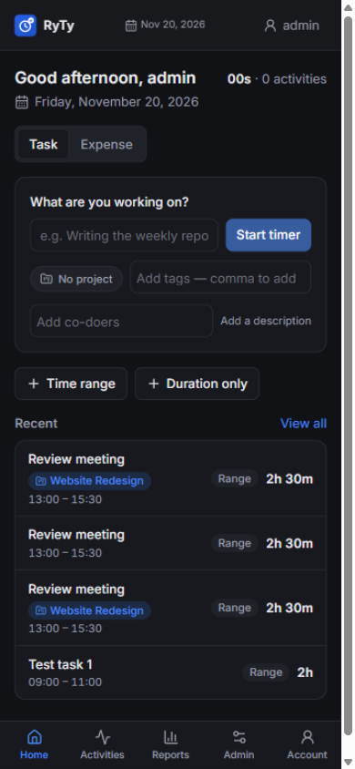
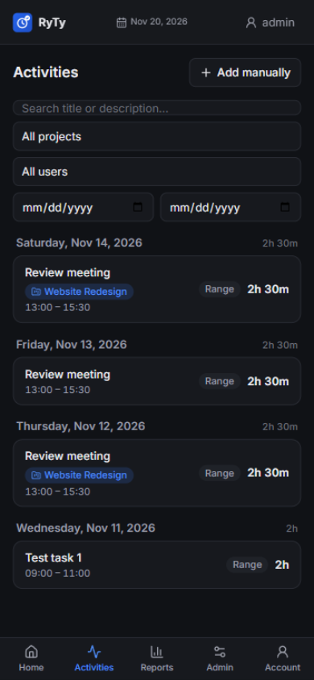
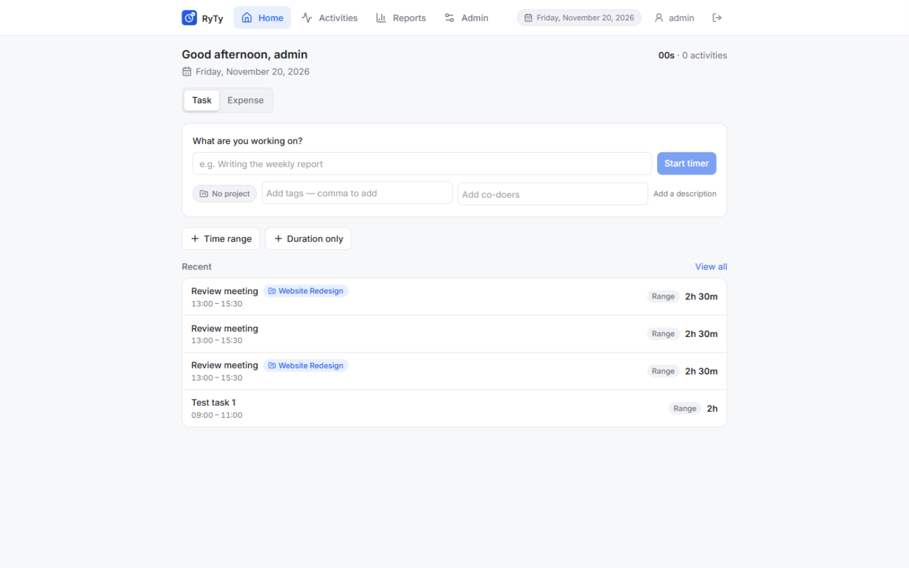
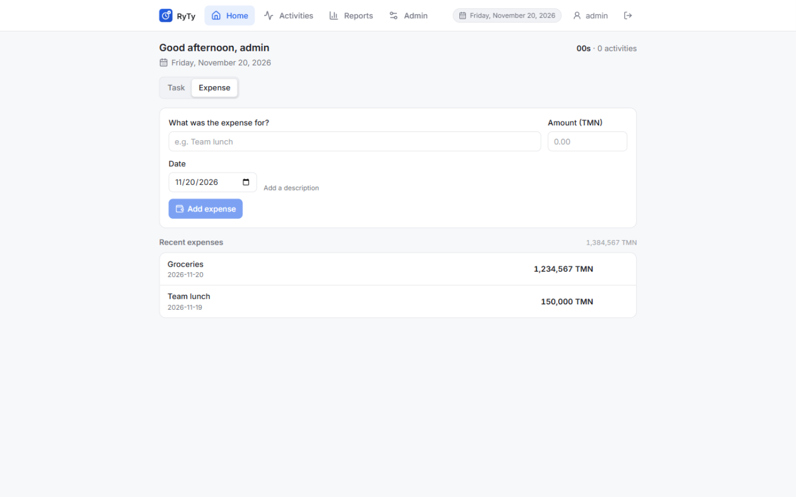
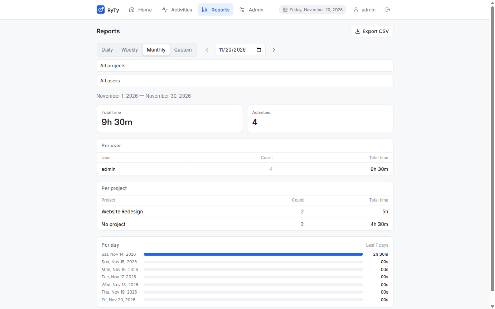

<div align="center">


# RyTy · رای‌تی

**Minimal team activity & time tracking — simple, fast, mobile-first.**

**ردیابی ساده و سریع فعالیت و زمان تیم — موبایل‌محور و کم‌حجم**

[](.github/workflows/ci.yml)


**English** · [فارسی](./README.fa.md)

</div>

---

## ✨ What is RyTy?

RyTy is a lightweight tool for teams to record **what** they worked on, **how long** it took, and **when** — nothing more. The core loop is three interactions:

1. Open the app
2. Type what you're working on → start the timer (or add time manually)
3. Leave

- ⏱️ **Timer tracking** — start / pause / resume / stop / cancel; timekeeping is computed **server-side** and survives refreshes and closed tabs
- ✍️ **Manual entry** — time range (with overlap detection) or duration-only
- 💸 **Expenses** — quick expense entry from a second Home tab, with a thousands-separated amount input; admin-configurable currency label (TMN, IRR, USD, …)
- 🗓️ **Jalali or Gregorian display** — admin setting; all data stays UTC/Gregorian underneath, and today's date shows in the app header
- 📁 **Projects** — admins define public (team-wide) or private projects; users can create their own or suggest one to the admin for public review; everyone can pick a **default project**
- 🏷️ **Tags** — public tags anyone can create; type a tag and press `,` to attach it, with instant autocomplete
- 👥 **Co-doers** — add teammates to any task as pair-doers; they see it in their own list and can edit or delete it, while time stays attributed to you
- 🧹 **Soft delete** — deleted activities/expenses are hidden from the app but kept in the database for audit
- 📊 **Reports** — daily / weekly / monthly / custom, grouped by day, user, project and activity, with **CSV export** (UTF-8, Persian-safe)
- 👥 **Two roles** — Admin (user management, app settings) and User; no public registration
- 🔒 **Secure by design** — session cookies (hashed tokens, HttpOnly), PBKDF2 password hashing, login rate limiting, CSRF protection, mandatory first-login password change, secret-based admin bootstrap
- 🌍 **English + Persian (فارسی)** — full RTL/LTR layouts, Persian digits & dates, Vazirmatn typography
- 🌗 **Light / dark / system themes**
- 📱 **Mobile-first UI** with a compact desktop layout
- ☁️ **Two deployment targets from one codebase** — Cloudflare Workers + D1, or Docker + SQLite

## 🖼️ Screenshots

| Mobile (dark)                                                        | Mobile — Persian RTL (Jalali date)                                     |
| -------------------------------------------------------------------- | ---------------------------------------------------------------------- |
|  |  |

| Timer running                                            | Activities                                                 |
| -------------------------------------------------------- | ---------------------------------------------------------- |
|  |  |

| Desktop dashboard (light)                                          | Expenses (desktop, light)                                        |
| ------------------------------------------------------------------ | ---------------------------------------------------------------- |
|  |  |

| Reports (mobile)                                            | Administration — projects                                           |
| ----------------------------------------------------------- | ------------------------------------------------------------------- |
|  |  |

| Desktop reports (light)                                        |
| -------------------------------------------------------------- |
|  |

## 🏗️ Architecture

One monorepo, one shared codebase, two deployment targets:

```
ryty/
├── frontend/          # React 19 + Vite + Tailwind CSS 4 SPA (EN/FA, RTL, themes)
├── backend/           # Hono REST API (runtime-agnostic)
│   └── src/
│       ├── routes/        # auth, activities, timer, reports, admin
│       ├── middleware/    # auth, roles, CSRF
│       ├── services/      # business logic
│       ├── repositories/  # data access (drizzle)
│       ├── database/      # schema + D1 / libsql adapters + migrations
│       └── runtime/       # cloudflare.ts (Worker) · node.ts (Docker)
├── shared/            # types + zod schemas shared by FE & BE
├── migrations/        # SQL migrations (D1 & SQLite compatible)
├── docker/            # Dockerfile
└── wrangler.example.jsonc  # Cloudflare config template; wrangler.jsonc is generated from it (git-ignored)
```

|          | Cloudflare (primary)         | Docker                         |
| -------- | ---------------------------- | ------------------------------ |
| Server   | Single Worker (Hono)         | Node 22 + `@hono/node-server`  |
| Frontend | Workers Assets (same origin) | Served by the same Node server |
| Database | Cloudflare D1                | SQLite file on a volume        |
| Deploy   | `npm run deploy`             | `docker compose up -d --build` |

## 🚀 Quick start (local development)

```bash
npm install
D1_DATABASE_ID=00000000-0000-0000-0000-000000000000 npm run config:generate
# ↑ generates wrangler.jsonc for the LOCAL runtime — any valid UUID works,
#   never use your production database id here
npm run db:migrate:d1:local   # create local D1 schema
npm run dev                   # Vite dev server (Cloudflare runtime)
```

Then create `.dev.vars` (git-ignored) with `INITIAL_ADMIN_USERNAME` /
`INITIAL_ADMIN_PASSWORD` and sign in with those credentials.

### Run the Docker/Node build locally

```bash
npm run build
INITIAL_ADMIN_USERNAME=admin INITIAL_ADMIN_PASSWORD=choose-a-long-password npm start
```

## ☁️ Deploy to Cloudflare

The real `wrangler.jsonc` is **generated at deploy time** from the committed
template (`wrangler.example.jsonc`) using your D1 database id — nothing
environment-specific is committed to Git.

```bash
# 1. Create your own database (or reuse an existing one — never create a
#    new database just to redeploy an existing instance)
npx wrangler d1 create ryty

# 2. Generate wrangler.jsonc from the template with YOUR database id
D1_DATABASE_ID=<database_id-from-step-1> npm run config:generate

# 3. Configure the initial administrator (secret — never in Git)
npx wrangler secret put INITIAL_ADMIN_PASSWORD
# optional: npx wrangler secret put INITIAL_ADMIN_USERNAME  (default: admin)

# 4. Build, apply remote migrations and deploy
npm run deploy
```

Sign in with the bootstrap credentials → you are **forced to choose a new
password** before continuing. If the secret is missing you will see a setup
screen with exact instructions — RyTy never creates an insecure default admin
and never asks for secrets in a web form.

**GitHub integration (Cloudflare Workers Builds):** build command
`npm run config:generate && npm run build`, deploy command `npm run deploy:cf`,
and `D1_DATABASE_ID` configured under **Build variables and secrets** (build
variables are not the same as Worker runtime variables/secrets).

📖 **Full step-by-step guide:** [deployment-guide.md](./deployment-guide.md)
(راهنمای فارسی: [deployment-guide.fa.md](./deployment-guide.fa.md))

## 🐳 Deploy with Docker

```bash
cp .env.example .env
# edit .env → set INITIAL_ADMIN_PASSWORD (required)
docker compose up -d --build
```

- App + API on one origin: `http://localhost:3000`
- Data persists in the `ryty-data` volume — **updating or rebuilding the image never deletes data** (verified)
- Health check: `GET /api/health` (wired into the container healthcheck)

## ⚙️ Environment variables

| Variable                 | Required    | Description                                                               |
| ------------------------ | ----------- | ------------------------------------------------------------------------- |
| `D1_DATABASE_ID`         | Cloudflare build | Your D1 database id; injected into the generated `wrangler.jsonc` during the build |
| `INITIAL_ADMIN_USERNAME` | –           | Bootstrap admin username (default `admin`)                                |
| `INITIAL_ADMIN_PASSWORD` | ✅ (secret) | Bootstrap admin password; used only until first login, then forced change |
| `APP_TIMEZONE`           | –           | Fallback timezone for day grouping (default `UTC`)                        |
| `DEFAULT_LANGUAGE`       | –           | Default UI language `en` \| `fa` (default `en`)                           |
| `RYTY_PORT`              | –           | Docker host port (default `3000`)                                         |
| `DATA_PATH`              | –           | SQLite file path for Docker/Node (default `/data/ryty.db`)                |

Cloudflare uses the same names as Worker **vars** (non-secrets) and **secrets** (`INITIAL_ADMIN_PASSWORD`).

## 🧪 Development

```bash
npm run typecheck   # strict TS across frontend / backend / shared
npm test            # 97 unit + integration tests (vitest)
npm run build       # production client + server build
```

Business rules (auth, authorization, timer lifecycle, report visibility) are enforced **server-side** and covered by the integration suite, which runs the production Hono app against SQLite.

## 📄 Documentation

- [deployment-guide.md](./deployment-guide.md) — **complete Cloudflare deployment guide** (manual + GitHub integration) · [فارسی](./deployment-guide.fa.md)
- [PROJECT-SPECIFICATION.md](PROJECT-SPECIFICATION.md) — authoritative product & technical specification
- [AGENTS.md](AGENTS.md) — instructions for coding agents
- [PROGRESS.md](PROGRESS.md) — implementation tracker & test log

## 📜 License

[MIT](./LICENSE)

---

<div align="center">

Made with care · ساخته‌شده با دقت

</div>
